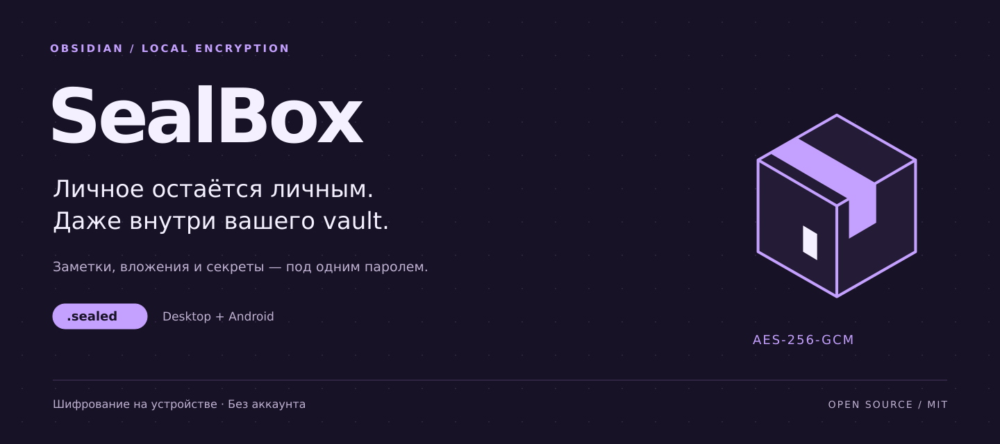
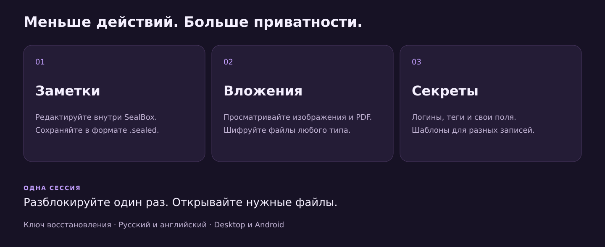
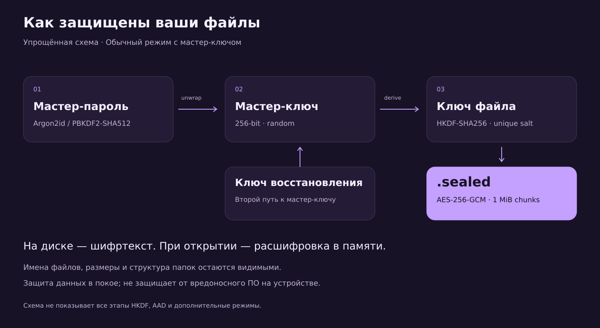

[English](README.md) · [Релизы](https://github.com/Scar333/obsidian-sealbox/releases) · [Техническая документация](docs/TECHNICAL.md) · [Безопасность](SECURITY.md)

# SealBox

**Зашифрованные заметки, вложения и секреты. Прямо в Obsidian.**

SealBox создаёт личное пространство внутри вашего хранилища. Шифруйте заметки и вложения одним мастер-паролем, редактируйте защищённые заметки внутри плагина и храните логины во встроенном менеджере секретов. Работает на компьютере и Android, поддерживает русский и английский языки.

Аккаунт не нужен. Шифрование выполняется на вашем устройстве; плагин не отправляет содержимое файлов на сервер.

## Возможности

- **Личные заметки.** Редактируйте Markdown и текст внутри SealBox, сохраняя их в зашифрованные файлы `.sealed`.
- **Защищённые вложения.** Шифруйте файлы любых типов, просматривайте изображения и PDF внутри плагина.
- **Менеджер секретов.** Храните логины, используйте группы, теги, ссылки, собственные поля и шаблоны.
- **Одна разблокировка на сеанс.** Открывайте файлы с ключом хранилища без повторного ввода пароля для каждой заметки.
- **Ключ восстановления.** Создайте его заранее и храните вне vault вместе с резервной копией `keyring.json`.
- **Привычная синхронизация.** Передавайте зашифрованные файлы своими средствами. Синхронизируйте и keyring; текстовое слияние шифртекста нужно отключить.

## Как это работает

SealBox использует AES-256-GCM для шифрования, Argon2id для получения ключа из пароля с резервным вариантом PBKDF2-SHA512 и HKDF-SHA256 для ключей отдельных файлов. Случайный мастер-ключ отделяет пароль от содержимого файлов. Ключ восстановления позволяет получить доступ к тому же мастер-ключу другим способом.

При редактировании защищённой заметки расшифрованное содержимое остаётся в памяти; при сохранении записывается шифртекст. **Если после шифрования вы выбрали сохранение оригинала, этот оригинал остаётся читаемым.** Оригиналы в системной корзине и прежние копии в истории синхронизации или бэкапах также не становятся зашифрованными.

SealBox защищает содержимое файлов при хранении. Имена, размеры файлов и структура папок остаются видимыми. Плагин не защищает разблокированный сеанс от вредоносных программ или других плагинов Obsidian. Результаты проверки кода и её ограничения описаны в [отчёте по безопасности](docs/SECURITY-REVIEW.ru.md).

## Начало работы

Установите **Sealbox** через **Настройки → Плагины сообщества → Обзор**. [Страница в каталоге Obsidian](https://community.obsidian.md/plugins/sealbox). Для обновления установленного плагина используйте проверку обновлений в этом же разделе.

Ручная установка:

1. Скачайте `main.js`, `manifest.json` и `styles.css` из [GitHub Releases](https://github.com/Scar333/obsidian-sealbox/releases).
2. Поместите их в `<vault>/.obsidian/plugins/sealbox/`.
3. Перезапустите Obsidian и включите SealBox в разделе плагинов сообщества.
4. Задайте мастер-пароль, создайте ключ восстановления и запустите самопроверку в настройках SealBox.

Требуется **Obsidian 1.8.7+**. Перед шифрованием важных данных сделайте резервную копию vault. Без исправного keyring и действующего пароля либо настроенного ключа восстановления доступ к файлам с ключом хранилища восстановить нельзя.

## Восстановление без Obsidian

Файлы можно расшифровать локальной утилитой, включая Argon2id и каскадный режим. Сохраните подходящий keyring и пароль либо заранее настроенный ключ восстановления.

**[Пошаговая инструкция для ПК](docs/RECOVERY.ru.md)** · [English guide](docs/RECOVERY.en.md)

## Подробнее

[Установка](INSTALL.md) · [Формат файлов и модель угроз](docs/TECHNICAL.md) · [История изменений](CHANGELOG.md) · [Как сообщить об уязвимости приватно](SECURITY.md)

Лицензия MIT. См. [LICENSE](LICENSE).
