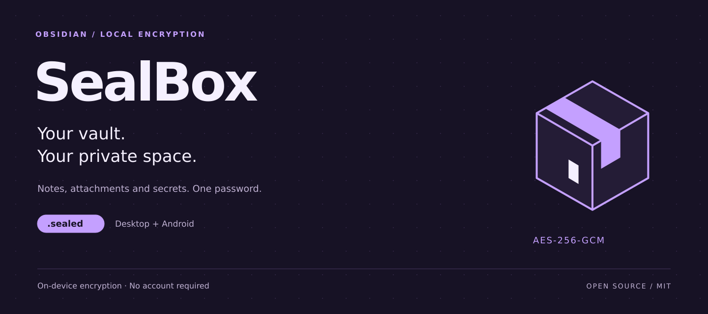
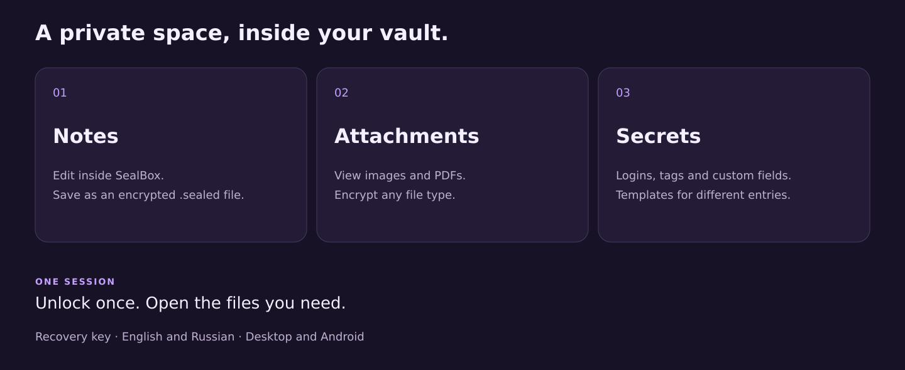
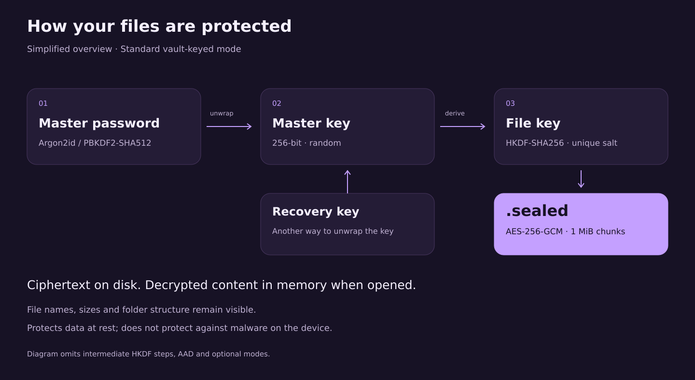

[Русский](README.ru.md) · [Releases](https://github.com/Scar333/obsidian-sealbox/releases) · [Technical documentation](../TECHNICAL.md) · [Security](../../SECURITY.md)

# SealBox

**Encrypted notes, attachments and secrets. Right inside Obsidian.**

SealBox brings a private space to your vault. Encrypt notes and attachments with one master password, edit sealed notes inside the plugin, and keep logins in a built-in secrets manager. Available on desktop and Android, in English and Russian.

No account required. Encryption happens on your device, and the plugin does not send your content to a server.

## What you can do

- **Write privately.** Edit Markdown and text in SealBox and save them as encrypted `.sealed` files.
- **Protect attachments.** Encrypt any file type; view images and PDFs inside the plugin.
- **Organize secrets.** Store logins with groups, tags, links, custom fields and templates.
- **Unlock once per session.** Access vault-keyed files without entering a password for every note.
- **Prepare for recovery.** Create a recovery key and keep it outside your vault, together with a backup of `keyring.json`.
- **Keep your workflow.** Sync encrypted files using your existing tools. Sync the keyring too; ciphertext must not be text-merged.

## How it works

SealBox uses AES-256-GCM for encryption, Argon2id for password derivation with a PBKDF2-SHA512 fallback, and HKDF-SHA256 for per-file keys. A random master key separates your password from your files. A recovery key provides another way to unlock that master key.

When you edit a sealed note, decrypted content stays in memory; saving writes encrypted content. **If you choose to keep an original file after sealing, that original remains readable.** Originals in the system trash and earlier copies in sync history or backups are not encrypted retroactively.

SealBox protects file contents at rest. File names, sizes and folder structure remain visible. It does not protect an unlocked session from malware or other plugins running inside Obsidian. The [security review report](../SECURITY-REVIEW.ru.md) documents the checks performed and their limitations.

## Get started

Install **Sealbox** from **Settings → Community plugins → Browse**. [Obsidian directory page](https://community.obsidian.md/plugins/sealbox). Existing installations can use the update check in Community plugins.

Manual installation:

1. Download `main.js`, `manifest.json` and `styles.css` from [GitHub Releases](https://github.com/Scar333/obsidian-sealbox/releases).
2. Place them in `<vault>/.obsidian/plugins/sealbox/`.
3. Reload Obsidian and enable SealBox in Community plugins.
4. Set a master password, create a recovery key and run the self-tests in SealBox settings.

Requires **Obsidian 1.8.7+**. Back up your vault before encrypting important files. Without a usable keyring and a valid password or configured recovery key, vault-keyed files cannot be recovered.

## Recovery without Obsidian

Your files remain accessible using a local recovery tool, including Argon2id and the optional cascade mode. Keep a matching keyring and your password or configured recovery key.

**[Step-by-step local recovery guide](../RECOVERY.en.md)** · [Russian guide](../RECOVERY.ru.md)

## Learn more

[Installation guide](../../INSTALL.md) · [Format and threat model](../TECHNICAL.md) · [Changelog](../../CHANGELOG.md) · [Report a vulnerability privately](../../SECURITY.md)

MIT licensed. See [LICENSE](../../LICENSE).
